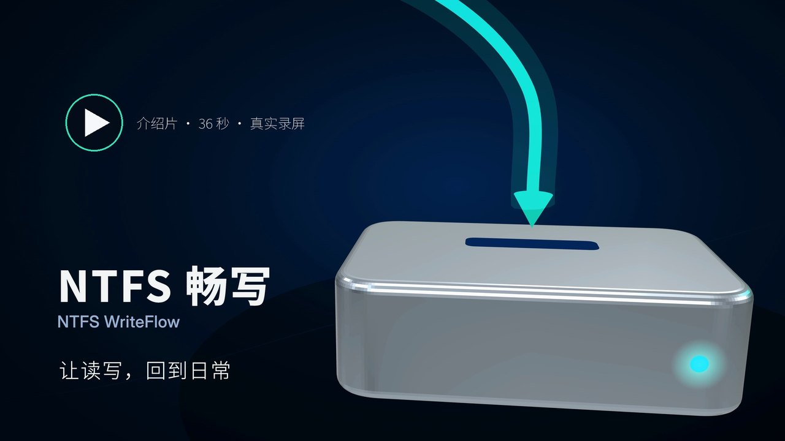

<div align="center">


# NTFS 畅写 · NTFS WriteFlow

**完整介绍** · [简要说明](README.en.md)

在 Mac 上读写 NTFS，把磁盘交还给日常使用。

[](LICENSE)
[](#安装)
[](#安装)
[](#验证状态与边界)
[](https://github.com/dososo/ntfs-writeflow/releases/tag/v0.3.0)
[](#技术栈与架构)

<p>
  <a href="https://github.com/dososo/ntfs-writeflow/releases/download/v0.3.0/NTFS-WriteFlow-0.3.0-universal.dmg"><strong>⬇ 下载 Mac 应用（DMG）</strong></a>
  &nbsp;·&nbsp;
  <a href="https://github.com/dososo/ntfs-writeflow/releases/download/v0.3.0/NTFS-WriteFlow-0.3.0-universal.zip">ZIP 下载</a>
  &nbsp;·&nbsp;
  <a href="https://github.com/dososo/ntfs-writeflow/releases/tag/v0.3.0">全部 Release 附件</a>
</p>
<p><sub>0.3.0 兼容预览 · Intel 与 Apple Silicon 通用包 · macOS 13 及以上</sub></p>

</div>

**0.3.1（构建10）正在验收，尚未发布。** 下载仍为0.3.0；Intel通用包、最低macOS13和macFUSE兼容前端是0.3.0已有能力。本轮完善旧FSKit资源能力、准确写入状态和卸载收尾，并修正窗口与平台提示。构建9虽完成VFS步骤，停用错误16仍使完整链失败；构建10的15.4受控镜像完整链已通过，见[发行草案](发布/0.3.1兼容预览发行说明.md)。

> 免费开源的 macOS NTFS 工具：查看真实磁盘状态，选择只读或读写挂载，在 Finder 中管理文件，完成操作后正常卸载或安全推出整盘。

<div align="center">
  <a href="https://dososo.github.io/ntfs-writeflow/"></a>
  <br><sub><b>▶ NTFS 畅写 · 36 秒介绍片</b> · 真实录屏 &nbsp;·&nbsp; <a href="https://dososo.github.io/ntfs-writeflow/"><b>在线观看</b></a>（手机可看） &nbsp;·&nbsp; <a href="https://github.com/dososo/ntfs-writeflow/releases/download/v0.1.1/NTFS-WriteFlow-0.1.1-intro-36s-1080p.mp4">下载视频</a></sub>
</div>

## NTFS 畅写是什么

NTFS 畅写是一款 **macOS 原生 NTFS 桌面应用**，用SwiftUI集中呈现磁盘状态、Finder入口与正常卸载。0.3.1候选根据系统和访问模式选择后端：15.4～26.3只读使用系统原生NTFS，读写使用随包FSKit扩展；26.4及以上只读／读写均使用FSKit。13～15.3使用用户安装的官方macFUSE和随包兼容前端。FSKit与macFUSE路径共用NTFS-3G引擎，系统原生只读不经过该引擎。

应用界面和当前维护文档使用简体中文。此前版本在已测环境完成核心读写、正常卸载与外部固定硬盘安全推出的真实验证；本轮构建10已完成15.4 ARM客体受控镜像完整链，实体盘本轮另验。**当前定位为兼容预览候选，不能作为所有系统、硬件和NTFS磁盘均已验证的稳定版承诺**。

## 为什么做 NTFS 畅写

连接一块 NTFS 磁盘，应该能看懂它由谁挂载、当前能否写入，以及离开前需要完成什么操作。我们希望用一个原生、直接的界面，把这些状态和动作放在一起，同时把实现、测试和限制公开。

免费是分发方式；清楚说明数据操作边界，是产品的一部分。

## 核心功能

- **真实卷状态**：显示文件系统、容量、挂载位置和当前访问状态；旧FSKit受管读写缺少本次内部准备证明时显示“写入未就绪”，刷新不沿用旧挂载的成功状态。默认关注NTFS，也可查看其他文件系统。
- **只读与读写挂载**：15.4～26.3只读走系统原生NTFS，读写走FSKit；26.4起两种模式均走FSKit，13～15.3走macFUSE。15.4～26.3全部挂载请求都经管理员服务；其他组合仍按权限与介质条件核验。
- **Finder 文件操作**：创建文件、目录、重命名与复制；既有已测环境验证了中文、长名称、扩展属性、大文件和稀疏文件，具体版本范围见验收记录。
- **正常卸载与整盘推出**：同步卷、正常卸载同盘分卷，再请求整盘推出并核对结果；遇到占用或错误不强制卸载。对仍保持物理连接的固定 USB 硬盘，明确区分“已安全推出”与“设备已移除”。
- **菜单栏与设置**：查看卷、调整自动刷新、管理挂载服务，导出本地诊断；设置和诊断窗口支持滚动，长说明和底部按钮可达。
- **特殊项与未知事务保护**：不支持Interix字符／块设备、FIFO和socket；同整盘尚有未决挂载票据时停止新请求，超时或身份未知时保留现场。
- **其他驱动状态识别**：如卷已由另一驱动挂载，明确显示来源，不自动抢占，也不把其他驱动的读写计为本应用成功。

**固定 USB 硬盘推出后仍可能留在系统设备树中，这是正常的连接状态。** 本应用只有在推出请求成功、确认原介质身份和容量未变、同盘无挂载且所有介质打开引用均关闭后，才显示“已安全推出，设备仍连接，可以断开”。镜像和可移除介质仍要求原对象消失；仅卸载不会显示可拔盘。应用刷新发现其他程序重新挂载时，会撤销本会话的已推出状态。详见[版本说明](发布/版本说明.md)。

## 界面一览

<div align="center">
  
  <br><sub><b>读写状态一眼可见</b> — 实际测试卷由 blntfs 挂载，Finder、卸载和整盘弹出入口集中呈现。</sub>
</div>

<br>

<div align="center">
  
  <br><sub><b>等到结果，再断开</b> — 测试镜像弹出后从清单消失；固定 USB 硬盘另以“已安全推出，设备仍连接”明确反馈。</sub>
</div>

<br>

<div align="center">
  
  <br><sub><b>权限与偏好放在一起</b> — 菜单栏、自动刷新与管理员服务授权状态均可查看。</sub>
</div>

截图来自此前已验收版本与专用的 `WriteFlow Demo` 测试镜像。图片中的临时设备编号、挂载路径不适用于其他机器；不是可复制的操作命令。

**0.3.0 根据用户反馈补齐 Intel 通用包与旧系统实际运行路径**，解决最低系统、窗口 API 和卸载接口阻断，增加 macOS 13～15.3 的真实 macFUSE 读写后端、整盘互斥与最终写回回执。保留 0.2.0 的逐盘自动挂载、登录启动、会话保护与写前预检；自动管理默认关闭。MacFUSE 需用户自行安装批准，目标系统／Intel 硬件仍待验；macOS 27.2 实体盘 Issue #3 保持待复测。[查看本版更新与支持矩阵](发布/0.3.0兼容预览发行说明.md)。

**0.3.1的五项变化（候选）**：

- **旧FSKit同步访问**：修正旧系统模块发现和用户身份，旧协议子类取得资源同步访问能力；15.4～26.3只读使用系统原生NTFS，读写仍FSKit，26.4起两种模式均FSKit。
- **失败保RO与准确状态**：原只读仍存活时的资源／NTFS预检／身份拒绝保留可读；只有内核RW而内部未就绪时明确提示，刷新或重启不沿用旧成功。
- **本次挂载独立绑定**：内部准备证明绑定本次卷与介质，跨阶段许可一致；被动查询不启动写入，重挂不能套用迟到的旧证明。
- **根缓存停用收尾**：补旧系统漏卸载回调，区分FSKit保留的根缓存与真实非根占用；force／实际忙项仍拒，收尾原错锁存。新构建10的15.4受控镜像完整链与内部收尾已通过。
- **首次构建稳定与探针可复跑**：兼容源码先归档再解包；物理判定使用DA／IOMedia互证，缺失或冲突继续拒。验收工具给出完整构建命令和明确模拟／实际回放入口，不把模拟称实盘通过。

设置／诊断的滚动、长错误及导出可达已并入本版；Apple虚拟机13～15.3的macFUSE内核路径明确拒绝，特殊项和未知事务保护继续保留。13.7.4／14.0只有安装、界面和限制提示等分项，兼容VFS未通过。

[构建10源码](https://github.com/dososo/ntfs-writeflow/commit/206af70bb138252bb090064252a47a8ff2bfec69)已增加根缓存与真实占用的区分：新收尾47项两架构、原四runner两架构及六目标严格检查通过，独立审查无新增确定P0／P1。构建9的VFS步骤通过但停用错误16仍判完整失败。旧FSKit的`nosuid`／`nodev`／`nobrowse`未全部保留，特殊项约束不代替内核保护，Intel实体机与26.0～26.3实际系统仍待验。详细记录见[可核验说明](发布/0.3.1可核验说明.md)。本轮发行基于206af70的475项冻结输入；App与DMG分别公证通过，21文件摘要／大小／权限一致，严格签名、Gatekeeper和stapler检查均退出0。构建10在macOS15.4（24E248）ARM客体的受控镜像完整链及内部sync0／close0／RO重开0已核验通过；本机实盘及最终源码分发仍待验。

## 安装

**运行目标**：macOS 13 及以上，Intel 与 Apple Silicon 通用包。已有macOS26.6.2的ARM／Rosetta执行，以及13.7.4／14.0的ARM客体分项实测；后者没有完成兼容后端VFS读写。最低系统构建、Rosetta或虚拟机结果均不等于Intel硬件和旧系统实体机全部验收通过。

下表描述0.3.1候选路由；目前下载按钮仍指向已发布0.3.0，该版路径见其[固定发行说明](发布/0.3.0兼容预览发行说明.md)。

| 系统 | 只读 | 读写 | 服务与前置 |
| --- | --- | --- | --- |
| macOS13～15.3 | macFUSE兼容前端 | macFUSE兼容前端 | 用户自行安装批准[官方macFUSE](https://github.com/macfuse/macfuse/wiki/Getting-Started)，配置管理员服务；Apple Silicon可能需要本人按官方流程调整启动安全 |
| macOS15.4～25.x | 系统原生NTFS | FSKit＋独立身份桥接 | 所有请求经管理员服务；按应用诊断完成扩展启用 |
| macOS26.0～26.3 | 系统原生NTFS | FSKit系统挂载 | RO／RW均强制经管理员服务；RW的系统命令与可信`SUDO_UID`发现方式保持 |
| macOS26.4及以上 | FSKit | FSKit | 启用文件系统扩展；按介质权限使用管理员服务 |

公开`requestedMountOptions`到26.4才可用，因此原生只读覆盖至26.3。26.0～26.3目前只有策略／模拟回归，没有这些实际系统的通过结论；26及以上仍保留按文件句柄的`funmount`卸载。最低系统、双架构和路由接线不是目标系统完整验收。

Apple虚拟机的13～15.3无法使用该macFUSE内核路径；0.3.1候选会明确拒绝，不应通过重复安装或降低安全保护绕过。15.4及以上的自有FSKit路径不按该规则禁用，实际兼容性仍须分项验证。

从 [0.3.0 兼容预览 Release](https://github.com/dososo/ntfs-writeflow/releases/tag/v0.3.0) 下载 [DMG 安装包](https://github.com/dososo/ntfs-writeflow/releases/download/v0.3.0/NTFS-WriteFlow-0.3.0-universal.dmg) 或 [应用 ZIP](https://github.com/dososo/ntfs-writeflow/releases/download/v0.3.0/NTFS-WriteFlow-0.3.0-universal.zip)。同页提供完整对应源码、`SHA256SUMS.txt` 和分发验证记录。

1. 先校验附件，将 `NTFSWriteFlow.app` 放入个人 `~/Applications` 固定位置。
2. macOS 15.4 及以上在系统设置启用本应用 FSKit 文件系统扩展；13～15.3 先按官方说明准备 macFUSE。本应用不安装第三方驱动，也不自动修改系统安全设置。
3. 在应用设置配置管理员挂载服务，按 macOS 系统窗口完成授权。先使用可丢弃测试卷；已有其他驱动挂载时，通过原工具正常卸载。
4. 选择只读或读写挂载并核对来源和模式，随后在 Finder 访问；完成后正常卸载／安全推出，等待明确结果。兼容后端每块整盘同时只支持一个分区会话。

整盘设备访问可能另行触发前台系统认证，请本人在macOS窗口使用Touch ID或密码。取消授权、占用或未知时停止。macFUSE兼容后端还需核对持久最终回执；FSKit卸载的内核成功不能单独证明扩展最终关闭，错误是否传回App仍有待验边界。旧系统在root私有一次性目录与身份租约下正常路径卸载；26以上保留按文件句柄卸载，详见发行说明。

完整步骤与移除服务、卸载应用的顺序见[安装与卸载](发布/安装与卸载.md)。

## 验证状态与边界

现代系统本轮改用本机macOS26.6.2与已授权5TB外部USB的一轮实际验收，文件写读／同步／占用拒绝／RO重挂结果尚待。不会额外启动26.4 VM；26.4仅处镜像准备，未启动、未通过。只读DA／IOMedia元数据验证不等于实盘文件操作成功。

当前构建10的15.4受控镜像同包VFS与内部收尾已通过；App／DMG公证及制品检查已完成，最终源码分发和回下载仍待。构建9VFS工具退出0但deactivate Code16，完整链失败；13.7.4／14.0仍只有安装／界面等分项，兼容VFS未通过。阶段四构建8的负向保RO和正常清理不等于正向RW。各阶段见[可核验说明](发布/0.3.1可核验说明.md)。

以下表格保留历史版本分项；已发布0.3.0范围以其[发行说明](发布/0.3.0兼容预览发行说明.md)、[可核验说明](发布/0.3.0可核验说明.md)和Release附件为准：

| 范围 | 已验证行为 |
| --- | --- |
| 系统镜像 | 8 项功能用例：身份拒绝、并发小文件、重命名与打开句柄、稀疏文件、长名称与扩展属性、只读保护、磁盘满恢复、超过 4 GiB 文件写入与重挂载复读。 |
| 真实外部 NTFS 介质 | 指定新建目录内的读写、同步、中文目录操作、正常卸载，再由另一驱动全量复读测试文件与属性。 |
| 权限与错误 | 管理员服务策略、真实文件 ACL、XPC 句柄传递、错误签名拒绝、同步失败与生命周期测试。 |
| 0.1.1 整盘推出 | 实际外部固定 USB 硬盘通过应用安全推出，独立核对原介质、无挂载和全树关闭状态；测试镜像经 GUI 读写挂载、弹出后映射与原对象消失，65,573 字节文件经离线工具复读 SHA-256 一致；314 项非设备回归及 5 项系统弹出集成用例通过。此次真实盘弹出验收未新增测试写入。 |

已发布的0.3.0应用完成了Developer ID签名、Apple公证、票据装订和本机Gatekeeper核验，DMG与ZIP对应同一构建，并完成冻结源码离线重建。具体产物身份和验证范围见该Release附件 `分发验证摘要.json`、`构建对应记录.json` 与 `SHA256SUMS.txt`。0.3.1候选的正式签名不等于最终发行完成，最终VFS和分发结果仍待补齐；公证也不代表全部兼容性已经验证。

**尚未完成**：Windows 读取与写回、Windows 文件系统检查、真实掉电与异常拔插、睡眠唤醒、长期压力、真实多用户隔离、全新 Mac 安装与完整卸载。格式化、完整校验修复及通知等原定能力尚未全部交付；登录启动与每卷偏好已实现，真实登录和跨账户仍待验收。测试过专用目录不代表核验过整盘原有数据。

详细范围、保留的错误观察和待办见[已知问题与发布门禁](发布/已知问题与发布门禁.md)。

## 隐私与权限

文件操作在本机完成，当前应用没有账户系统、遥测或自动上传功能。应用内主动导出的诊断摘要不包含卷名、挂载路径、卷标识、账户或用户文件内容。自行附上的截图与系统日志需要另行检查，分享前移除不希望公开的信息。

管理员服务只接受通过签名校验的本应用请求，使用固定操作与介质身份核验。源码、权限边界和授权说明见[管理员挂载服务](发布/管理员挂载服务.md)。

## 从源码构建

需要 **Apple Silicon Mac、macOS 26、Xcode 26 与 macOS 26 SDK、XcodeGen、Autoconf、Automake、GNU Libtool**。已测构建基线为 Xcode 26.6、macOS SDK 26.5、XcodeGen 2.44.1。

从公开仓库克隆固定子模块并构建：

```sh
git clone --recurse-submodules https://github.com/dososo/ntfs-writeflow.git
cd ntfs-writeflow
git submodule update --init --recursive
NTFS_BUILD_CONFIGURATION=Release bash script/build_and_run.sh --build-only
```

从随发行提供的完整源码包构建时，使用离线路径：

```sh
bash 发布/准备离线源码.sh
NTFS_BUILD_CONFIGURATION=Release bash script/build_and_run.sh --build-only
```

构建10修复兼容后端首次归档的Git／tar管道中断，改为先落盘再解包；固定源码182文件已核对，最终发行源码仍须完整验收。

完整源码包包含固定版本 NTFS-3G 源码、上游 Git bundle 和哈希清单。准备脚本只恢复依赖的 Git 元数据，不覆盖源码、不安装驱动，恢复过程无需联网。GitHub 仓库保留真正的 Git 子模块引用，源码归档另附完整依赖树，不混淆两种交付方式。

默认构建同时生成两种架构，主程序／助手／兼容前端最低13，扩展最低15.4。可用 `NTFS_BUILD_ARCH=arm64` 或 `x86_64` 明确选择单架构开发包；发行采用默认通用包。产物为 `build/xcode/Build/Products/Release/NTFSWorkbench.app`。默认脚本使用临时签名；**能编译、能打开主窗口，不等于获得 FSKit 加载授权**。开发者自行分发需使用自己的 Developer ID、FSKit 描述文件与匹配标识，并核验管理员服务的签名策略。详见[源码与签名说明](发布/开源说明.md)。

```sh
bash script/test_engine.sh
bash ThirdParty/FSKitAdapter/Tests/run.sh
python3 -m unittest discover -s Tests -p 'test_signing_gate.py'
```

上述引擎与适配层测试创建独立文件镜像。系统测试及真实介质测试的范围、授权和清理要求见 [Tests](Tests/Core/README.md) 与[系统测试说明](Tests/System/README.md)。

## 技术栈与架构

| 组件 | 作用 |
| --- | --- |
| [SwiftUI 应用](Sources/App) | 磁盘清单、操作状态、Finder 入口、菜单栏、设置与诊断。 |
| [核心模型与保护规则](Sources/Core) | 介质身份、访问条件和结果校验；可信后端选择按系统版本与只读／读写分别决定。 |
| [管理员服务](Sources/PrivilegedHelper) | 经系统授权后执行受限挂载、正常卸载及整盘推出前准备，验证客户端签名和目标身份。 |
| [前台整盘推出](Sources/HelperShared/DiskEject.swift) | 由应用取得系统只读设备授权，绑定同一描述符请求推出，核验介质移除或固定盘安全关闭回执。 |
| [原生只读路由](Sources/PrivilegedHelper/HelperMedia.swift) | 15.4～26.3由管理员服务调用系统原生NTFS，复核`ntfs`、只读位、root所有者、介质和挂载实例；不使用NTFS-3G。 |
| [FSKit 适配层](ThirdParty/FSKitAdapter) | 15.4起的读写、26.4起的只读交给NTFS-3G；15.4至26以前使用独立身份桥、旧协议子类和受管内部准备，兼容漏卸载回调的收尾；现代基类不增加该协议与停用I/O。 |
| [旧系统兼容前端](Sources/LegacyBackend) | 将 macFUSE 回调接入同一 NTFS 引擎，持有授权 FD／整盘锁，并持久记录最后关闭结果。 |
| [C 桥接](ThirdParty/NTFSBridge)与 NTFS-3G | NTFS 文件和目录操作；固定上游版本并记录修改。 |

## 许可与来源

新增实现采用 [GNU GPL 第 2 版](LICENSE)，第三方组件保留各自许可证、版权和固定提交，见[第三方组件说明](第三方组件说明.md)。分发二进制时须提供匹配的完整对应源码与构建材料。

本项目使用开源 NTFS-3G 和经修改的开源桥接、适配代码；不包含 Paragon 私有驱动、授权文件、资源或反编译实现。对现有产品的行为研究不等于恢复其原始源码。

## 作者

**爆裂队长 NEXT · BLCaptain** · [GitHub：dososo](https://github.com/dososo)

<div align="center"><sub>NTFS 畅写 · NTFS WriteFlow — 免费开源，状态清楚，操作有据。</sub></div>
