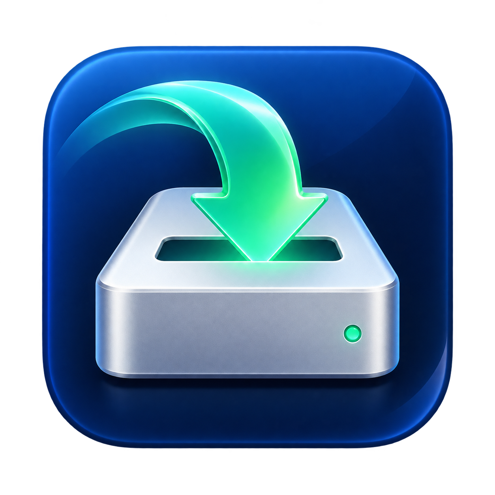
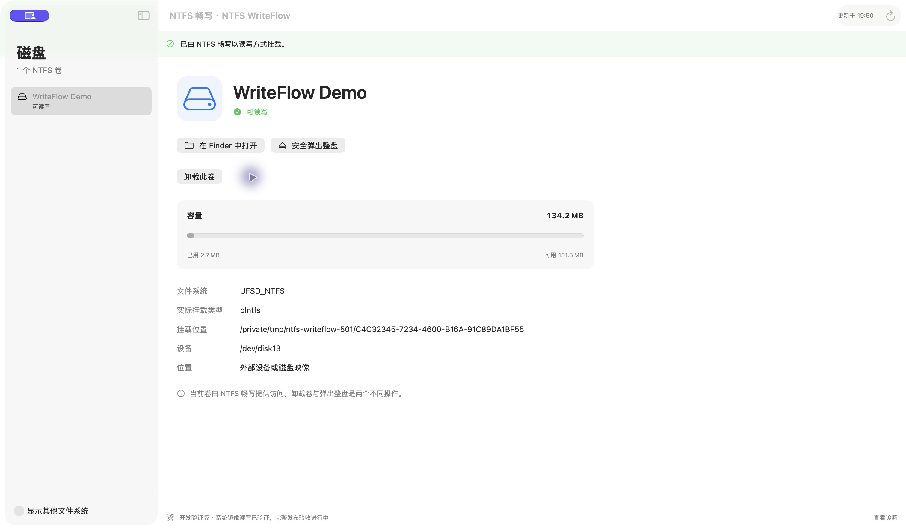
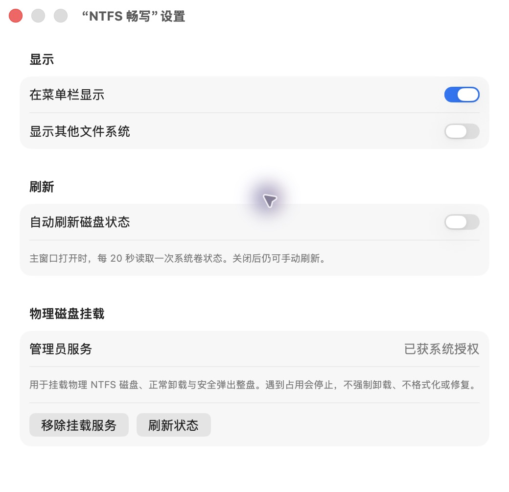
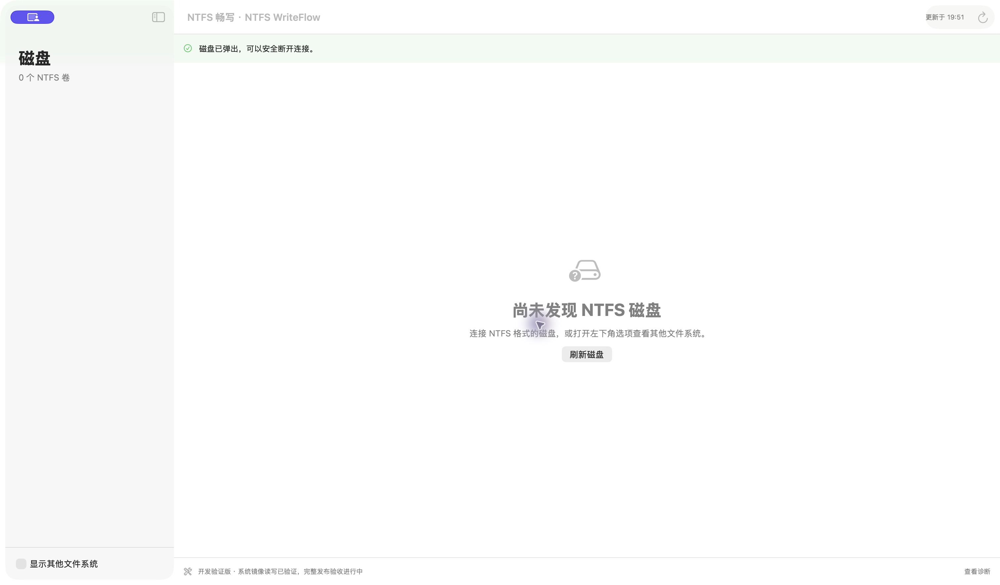

# NTFS 畅写 · NTFS WriteFlow

在 Mac 上查看 NTFS 磁盘、选择读写方式，用完后正常卸载。

**[下载 DMG 安装包](https://github.com/dososo/ntfs-writeflow/releases/download/v0.3.1/NTFS-WriteFlow-0.3.1-universal.dmg)** · [下载 ZIP](https://github.com/dososo/ntfs-writeflow/releases/download/v0.3.1/NTFS-WriteFlow-0.3.1-universal.zip) · [全部附件与校验记录](https://github.com/dososo/ntfs-writeflow/releases/tag/v0.3.1)

[简要介绍](README.en.md) · [版本变化](CHANGELOG.md) · [用户反馈与改进对照](发布/用户反馈与版本迭代对照.md)

**先了解当前范围：这是兼容预览，不是已在所有 Mac 和硬盘上验证的稳定版。** Intel 通用包和最低 macOS 13 从0.3.0就已提供；Intel实体机、13／14实体兼容链仍未验收。本机macOS26.6.2的0.3.1实盘挂载仍返回错误69，尚未完成读写。重要数据请先备份，具体范围见[已验证与未完成](#已验证与未完成)。

## 它能帮你做什么

macOS自带的NTFS访问通常只能读取。NTFS畅写把查看状态、选择只读或读写、打开Finder、正常卸载和推出整盘放进一个原生界面。

- **看清当前状态**：磁盘在哪里、由谁挂载、能不能写；准备未完成时显示“写入未就绪”。
- **手动选择只读或读写**：系统和权限允许后，再到Finder中操作文件；其他驱动正在使用的卷不会被自动抢走。
- **记住每块盘的选择**：可为指定磁盘设置下次插入时只读或读写，自动管理默认关闭。
- **用完正常退出磁盘**：先同步、卸载，再按需要安全推出整盘；遇到文件占用或错误会停止，不强制处理。
- **查看和导出诊断**：设置、菜单栏和诊断入口集中呈现，长说明和底部按钮可以滚动查看。

“卷已卸载”不等于“整盘可以拔”。需要断开时使用安全推出，等待应用给出明确结果；固定USB硬盘推出后仍显示连接，也可能是正常状态。

## 从第一次开源，到这次更新

第一次开源后，我们收到了不少关注和建议。更新主要沿着这些实际需求推进：

| 你关心的事 | 哪个版本做了什么 | 现在的边界 |
| --- | --- | --- |
| 能下载、看懂、自己检查源码 | **0.1.1首次公开预览**：应用下载、源码、界面演示，以及整盘安全推出反馈 | 历史演示不代表当前所有环境已通过 |
| 每次插盘都要重新选择 | **0.2.0**：逐盘记忆、插盘自动管理、可选登录启动 | 默认关闭；不是已完成20轮实盘或真实登录全场景验收 |
| Intel Mac和旧系统能不能用 | **0.3.0**：Intel／Apple Silicon通用包，主程序及兼容前端最低macOS13，接入旧系统运行后端 | 运行路径已实现，Intel实体机与旧系统实体兼容链仍未验 |
| 状态不准、旧系统挂载和卸载卡住 | **0.3.1**：修正发现与写入准备、失败时的只读保留、正常卸载收尾，完善窗口和诊断 | 本机26.6.2仍有系统发现阻断，不能说实盘问题全部解决 |

每项反馈对应的用法和限制，见[用户反馈与版本迭代对照](发布/用户反馈与版本迭代对照.md)。Intel、旧系统、自动挂载等是反馈主题归纳，不是假造的评论逐字引述。

## 0.3.1具体改了什么

1. **系统没列出扩展时，多一步正常核验。** macOS15.4起可由用户手动交给系统尝试挂载；明确关闭、查询报错或仍在等待时继续停止，自动挂载不会因此放行。这不等于扩展已经启用。
2. **不把“看起来能写”当作准备好了。** 需要内部准备的读写路径完成检查后才显示可写，刷新、重启或重新挂载不会沿用旧状态。
3. **写入前被拒，尽量保留原来的只读访问。** 原只读还在时，预检或身份检查失败会保留可读；已经关闭原只读或启动写入后发生的故障不在这个保证内。
4. **补齐旧系统的正常卸载收尾。** 区分系统保留的目录缓存和真实文件占用，处理同步、关闭错误，仍不强制卸载。
5. **设置更容易用，交付材料更完整。** 设置／诊断可滚动、可导出；修复源码首次构建及验收工具入口，提供对应源码与核验附件。

详见[0.3.1发行说明](发布/0.3.1兼容预览发行说明.md)。自动挂载来自0.2.0，Intel与旧系统运行路径来自0.3.0，这次没有把它们重新算作首次新增。

## 我的Mac能用吗

下表是当前实现和运行前置，不是“每种组合都已实机通过”的承诺。

| macOS | 使用方式 | 需要准备什么 |
| --- | --- | --- |
| 13～15.3 | 通过macFUSE兼容后端读写 | 自行安装并批准[官方macFUSE](https://github.com/macfuse/macfuse/wiki/Getting-Started)，配置管理员服务；Apple虚拟机不支持这条内核路径 |
| 15.4～26.3 | 只读用系统自带NTFS，读写用本应用的文件系统扩展 | 启用扩展并配置管理员服务；26.0～26.3实际系统仍未验 |
| 26.4及以上 | 只读／读写均用本应用的文件系统扩展 | 启用扩展；按磁盘权限使用管理员服务。本机26.6.2当前仍挂载失败 |

通用包包含Intel和Apple Silicon两种架构，但Rosetta执行不能代替Intel硬件验收。13／14虚拟机只完成安装、界面和限制提示等分项，兼容读写未通过；旧系统Apple Silicon使用macFUSE时，可能需要本人按官方流程批准组件和调整启动安全，本应用不会自动修改系统保护。

## 第一次怎么用

1. 从顶部下载DMG或ZIP，按同页`SHA256SUMS.txt`核对附件。把应用放在固定的“应用程序”目录；升级前先正常卸载卷、移除旧服务并退出旧应用。
2. macOS15.4起按应用诊断在系统设置启用文件系统扩展（FSKit）；13～15.3先准备官方macFUSE。模块没出现、不能启用或系统拒绝时，先查看已知问题，不反复强制挂载。
3. 需要管理员服务时，在设置的“物理磁盘挂载”中配置并按系统提示批准。已经由其他工具挂载的卷，先通过原工具正常卸载。
4. 在磁盘详情选择只读或读写，核对实际状态后打开Finder。完成后正常卸载；要拔盘时，再安全推出整盘并等待确认。

完整升级、权限与卸载顺序见[安装与卸载](发布/安装与卸载.md)。不要把密码发到聊天或Issue里，认证应在macOS自己的系统窗口完成。

## 想让选定的盘下次自动挂载

先确认手动流程适合你的环境，再启用这项可选功能：

1. 在磁盘详情的“下次插入此盘”里选择自动只读或读写。
2. 在设置的“插盘自动挂载”中打开“自动管理已选定的NTFS盘”，并“确认当前会话”。需要时再开启“登录时启动”。
3. 之后新插入该盘时，应用才按保存的选择处理。关窗继续运行，明确退出应用后停止；手动卸载后不会自动重挂。

发现其他磁盘驱动、身份不明或会话未确认时会暂停。锁屏／睡眠后不能沿用旧确认。当前没有20轮实体插盘、真实登录与跨账户全部通过的结论。

## 64秒看这次更新

[在线观看更新片](https://dososo.github.io/ntfs-writeflow/) · [下载16:9影片](https://github.com/dososo/ntfs-writeflow/releases/download/v0.3.1/NTFS-WriteFlow-0.3.1-update-16x9.mp4) · [影片内容与素材说明](发布/0.3.1更新片与发布素材.md)

影片包含本轮0.3.1（11）的设置、逐盘规则和诊断真实界面，以及已标注版本的0.1.1历史镜像操作；其余变化用功能图解说明。录制界面没有开启自动管理或执行磁盘挂载，不能把演示当作新增实盘验收。

## 界面与历史演示

截图和[36秒演示影片](https://github.com/dososo/ntfs-writeflow/releases/download/v0.1.1/NTFS-WriteFlow-0.1.1-intro-36s-1080p.mp4)来自**0.1.1等此前版本与专用测试卷**，不是0.3.1实盘验收录像。[在线观看历史演示](https://dososo.github.io/ntfs-writeflow/)。

## 已验证与未完成

| 范围 | 可以确认什么 |
| --- | --- |
| 0.3.1构建11的分发 | App和DMG通过签名、公证与Gatekeeper；对应源码、校验清单与分发记录在同版本[Release附件](https://github.com/dososo/ntfs-writeflow/releases/tag/v0.3.1)中 |
| 历史构建10／macOS15.4 ARM客体 | 受控镜像完成中文写读、同步、忙句柄拒绝、正常卸载、只读重挂复读及内部收尾；不移植为构建11同包实测 |
| 本机26.6.2／构建11／真实NTFS盘 | 请求进入系统后返回69，用户文件系统代理未找到目标短名；未观察到我方扩展启动，未新增测试文件，未完成实盘读写 |
| 仍未验收 | Intel实体、13／14实体兼容链、26.0～26.3实际系统、Windows互操作、掉电、异常拔插、长期压力、真实登录／跨账户和实体多轮 |

[Issue #3](https://github.com/dososo/ntfs-writeflow/issues/3)的macOS27.2原实体盘环境仍待复测，保持打开。本机26.6.2的69与该Issue不能只凭相同退出码认定为同一根因。

**关于速度和大文件：** 历史功能记录包含大文件，但不等于发布了延迟或吞吐成绩；当前没有与Paragon同条件的实测对比，不宣称更快或“不输商业驱动”。安装公证也不等于文件系统兼容性证明。

**关于数据边界：** 写前预检不是完整修复；本应用不提供格式化或完整文件系统修复。特殊文件和部分系统安全标志另有限制；详细范围与失败记录见[可核验说明](发布/0.3.1可核验说明.md)和[已知问题](发布/已知问题与发布门禁.md)。

## 源码、隐私和许可

应用不需要账户，当前没有遥测或自动上传；文件操作在本机完成。主动导出的诊断摘要会隐藏卷名、挂载路径和账户等信息；自行分享截图或日志前仍需检查内容。

[完整对应源码](https://github.com/dososo/ntfs-writeflow/releases/download/v0.3.1/NTFS-WriteFlow-0.3.1-source.tar.gz) · [源码与签名说明](发布/开源说明.md) · [第三方组件](第三方组件说明.md) · [GPL-2.0许可](LICENSE)

开发者构建需要Apple Silicon Mac、macOS／Xcode26与相应SDK，以及XcodeGen、Autoconf、Automake和GNU Libtool。下载源码附件后可用离线准备脚本恢复依赖元数据；这不是给普通安装用户增加的步骤。构建与组件细节见[源码说明](发布/开源说明.md)、[管理员服务](发布/管理员挂载服务.md)及[技术验收历史](发布/版本说明.md)。

**爆裂队长 NEXT · BLCaptain** · [GitHub：dososo](https://github.com/dososo)
