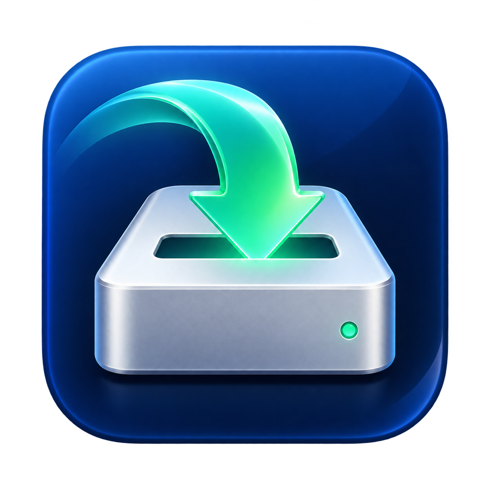
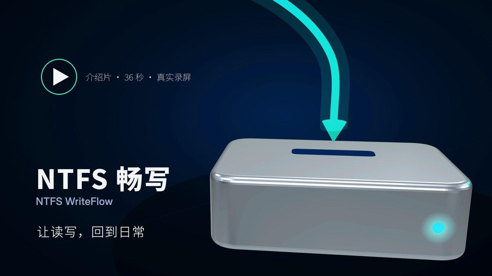
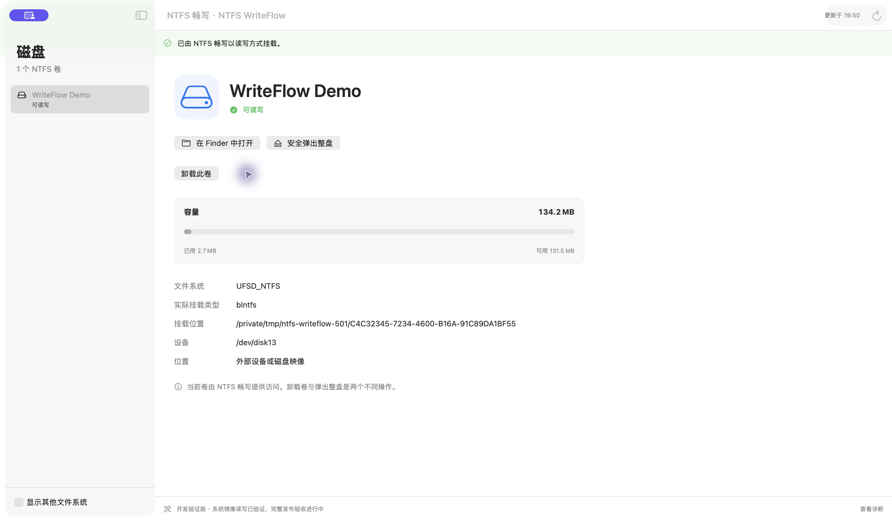
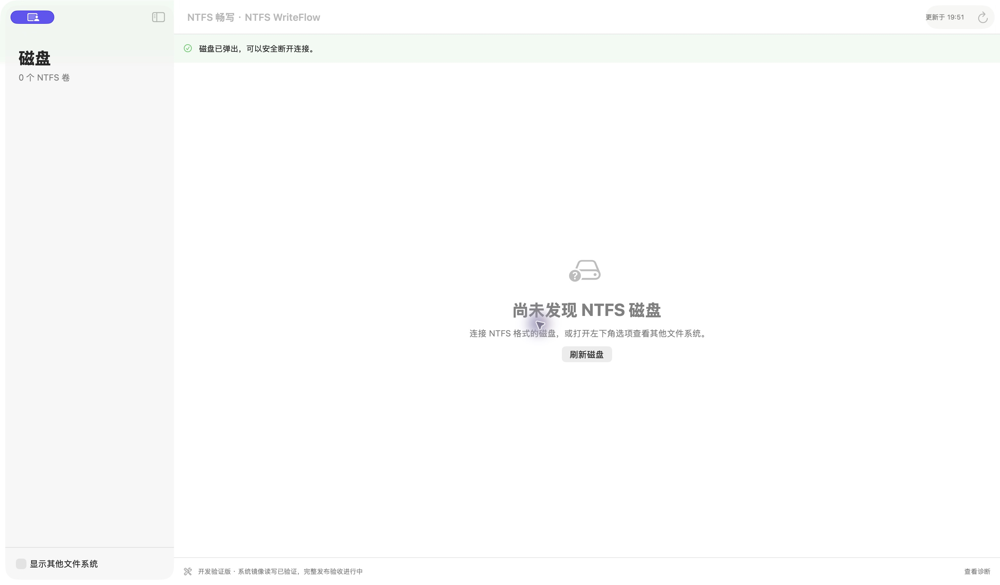
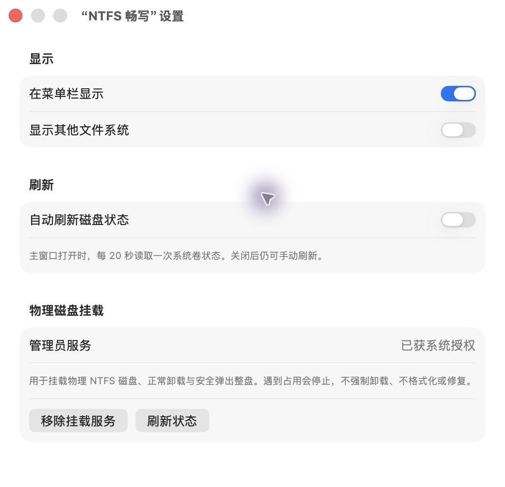

<div align="center">



# NTFS 畅写 · NTFS WriteFlow

**中文** · [English](README.en.md)

在 Mac 上读写 NTFS，把磁盘交还给日常使用。

[](LICENSE)
[](#安装)
[](#安装)
[](#验证状态与边界)
[](https://github.com/dososo/ntfs-writeflow/releases/tag/v0.1.2)
[](#技术栈与架构)

<p>
  <a href="https://github.com/dososo/ntfs-writeflow/releases/download/v0.1.2/NTFS-WriteFlow-0.1.2-arm64.dmg"><strong>⬇ 下载 Mac 应用（DMG）</strong></a>
  &nbsp;·&nbsp;
  <a href="https://github.com/dososo/ntfs-writeflow/releases/download/v0.1.2/NTFS-WriteFlow-0.1.2-arm64.zip">ZIP 下载</a>
  &nbsp;·&nbsp;
  <a href="https://github.com/dososo/ntfs-writeflow/releases/tag/v0.1.2">全部 Release 附件</a>
</p>
<p><sub>0.1.2 预览版 · Apple Silicon · macOS 26 及以上</sub></p>

</div>

> 免费开源的 macOS NTFS 工具：查看真实磁盘状态，选择只读或读写挂载，在 Finder 中管理文件，完成操作后正常卸载或安全推出整盘。

<div align="center">
  <a href="https://dososo.github.io/ntfs-writeflow/"></a>
  <br><sub><b>▶ NTFS 畅写 · 36 秒介绍片</b> · 真实录屏 &nbsp;·&nbsp; <a href="https://dososo.github.io/ntfs-writeflow/"><b>在线观看</b></a>（手机可看） &nbsp;·&nbsp; <a href="https://github.com/dososo/ntfs-writeflow/releases/download/v0.1.1/NTFS-WriteFlow-0.1.1-intro-36s-1080p.mp4">下载视频</a></sub>
</div>

## NTFS 畅写是什么

NTFS 畅写是一款 **macOS 原生 NTFS 桌面应用**。SwiftUI 提供磁盘界面，Apple FSKit 承载用户空间文件系统，NTFS-3G 提供 NTFS 引擎。通过本应用挂载的卷以 `blntfs` 标识，在 Finder 和普通文件操作中使用。

应用界面目前为简体中文，并提供英文 README 使用与构建说明。核心读写、正常卸载与外部固定硬盘安全推出已完成真实验证。正在补齐完整产品能力与兼容性验收，**当前定位为开发候选，不能作为所有 NTFS 磁盘均已验证的稳定版承诺**。

## 为什么做 NTFS 畅写

连接一块 NTFS 磁盘，应该能看懂它由谁挂载、当前能否写入，以及离开前需要完成什么操作。我们希望用一个原生、直接的界面，把这些状态和动作放在一起，同时把实现、测试和限制公开。

免费是分发方式；清楚说明数据操作边界，是产品的一部分。

## 核心功能

- **真实卷状态**：显示文件系统、容量、挂载位置和当前访问状态；默认关注 NTFS，也可查看其他文件系统。
- **只读与读写挂载**：由 FSKit 与 NTFS-3G 提供文件访问，物理盘通过经系统授权的管理员服务挂载。
- **Finder 文件操作**：创建文件、目录、重命名与复制；已验证中文、长名称、扩展属性、大文件和稀疏文件。
- **正常卸载与整盘推出**：同步卷、正常卸载同盘分卷，再请求整盘推出并核对结果；遇到占用或错误不强制卸载。对仍保持物理连接的固定 USB 硬盘，明确区分“已安全推出”与“设备已移除”。
- **菜单栏与设置**：查看卷、调整自动刷新、管理挂载服务，导出本地诊断。
- **其他驱动状态识别**：如卷已由另一驱动挂载，明确显示来源，不自动抢占，也不把其他驱动的读写计为本应用成功。

**固定 USB 硬盘推出后仍可能留在系统设备树中，这是正常的连接状态。** 本应用只有在推出请求成功、确认原介质身份和容量未变、同盘无挂载且所有介质打开引用均关闭后，才显示“已安全推出，设备仍连接，可以断开”。镜像和可移除介质仍要求原对象消失；仅卸载不会显示可拔盘。应用刷新发现其他程序重新挂载时，会撤销本会话的已推出状态。详见[版本说明](发布/版本说明.md)。

## 界面一览

<div align="center">
  
  <br><sub><b>读写状态一眼可见</b> — 实际测试卷由 blntfs 挂载，Finder、卸载和整盘弹出入口集中呈现。</sub>
</div>

<br>

<div align="center">
  
  <br><sub><b>等到结果，再断开</b> — 测试镜像弹出后从清单消失；固定 USB 硬盘另以“已安全推出，设备仍连接”明确反馈。</sub>
</div>

<br>

<div align="center">
  
  <br><sub><b>权限与偏好放在一起</b> — 菜单栏、自动刷新与管理员服务授权状态均可查看。</sub>
</div>

截图来自当前应用与专用的 `WriteFlow Demo` 测试镜像。图片中的临时设备编号、挂载路径不适用于其他机器；不是可复制的操作命令。

0.1.2 修复关闭阶段错误回传并完善诊断提示；[查看本版验收与限制](发布/0.1.2验收记录.md)。

## 安装

> **目标环境**：macOS 26 及以上 · Apple Silicon。当前实测为 macOS 26.6.2；Intel、旧系统和所有 macOS 26 小版本未完成兼容性验证。

从 [0.1.2 预览版 Release](https://github.com/dososo/ntfs-writeflow/releases/tag/v0.1.2) 下载 [DMG 安装包](https://github.com/dososo/ntfs-writeflow/releases/download/v0.1.2/NTFS-WriteFlow-0.1.2-arm64.dmg) 或 [应用 ZIP](https://github.com/dososo/ntfs-writeflow/releases/download/v0.1.2/NTFS-WriteFlow-0.1.2-arm64.zip)。同一页面提供完整对应源码、`SHA256SUMS.txt` 和分发验证记录。此版本保持开发预览定位。

安装步骤：

1. 核对随包 `SHA256SUMS.txt`，解压应用 ZIP，将 `NTFSWriteFlow.app` 放入个人主目录的 **`Applications`** 文件夹，即 `~/Applications`。这是当前实际验收的位置。
2. 从该固定位置打开应用，在 **系统设置 → 通用 → 登录项与扩展 → 文件系统扩展** 中启用模块。部分系统需要进入“按类别”查看。
3. 如需挂载物理盘，打开应用 **设置 → 物理磁盘挂载 → 配置管理员挂载服务**，在 macOS 系统窗口完成授权。
4. 选择测试卷的只读或读写挂载，确认实际挂载类型为 `blntfs`，再在 Finder 中访问。已有其他驱动挂载时，先保存文件并通过原工具正常卸载。
5. 完成后正常卸载或按已验证的整盘弹出流程操作，等待系统结果；失败时处理占用后重试。

文件系统扩展和管理员服务是两项独立系统授权。整盘弹出流程还可能触发前台的 macOS 设备访问认证；请本人在系统窗口使用 Touch ID 或本机密码完成，不向聊天、问题报告或应用自定义表单提供密码。已有管理员服务授权不保证本次设备操作获得许可。取消授权或系统拒绝时，卷可能已卸载，但整盘尚未弹出；等待明确结果，不将卸载成功当作可拔盘。不要求关闭 SIP、禁用 Gatekeeper、降低启动安全或向后台服务授予完全磁盘访问权限。公证状态须以**该版本对应产物**的验证记录为准，不能沿用旧版结论。

完整步骤与移除服务、卸载应用的顺序见[安装与卸载](发布/安装与卸载.md)。

## 验证状态与边界

已经执行的验证包括：

| 范围 | 已验证行为 |
| --- | --- |
| 系统镜像 | 8 项功能用例：身份拒绝、并发小文件、重命名与打开句柄、稀疏文件、长名称与扩展属性、只读保护、磁盘满恢复、超过 4 GiB 文件写入与重挂载复读。 |
| 真实外部 NTFS 介质 | 指定新建目录内的读写、同步、中文目录操作、正常卸载，再由另一驱动全量复读测试文件与属性。 |
| 权限与错误 | 管理员服务策略、真实文件 ACL、XPC 句柄传递、错误签名拒绝、同步失败与生命周期测试。 |
| 0.1.1 整盘推出 | 实际外部固定 USB 硬盘通过应用安全推出，独立核对原介质、无挂载和全树关闭状态；测试镜像经 GUI 读写挂载、弹出后映射与原对象消失，65,573 字节文件经离线工具复读 SHA-256 一致；314 项非设备回归及 5 项系统弹出集成用例通过。此次真实盘弹出验收未新增测试写入。 |

本版本应用已完成 Developer ID 签名、Apple 公证、票据装订和本机 Gatekeeper 核验；DMG 与 ZIP 的内嵌应用对应同一已验收构建。产品源码与构建资源冻结后完成离线重建；公开下载说明随本次发布更新。具体产物身份和验证范围见 Release 附件 `分发验证摘要.json`、`构建对应记录.json` 与 `SHA256SUMS.txt`，公证不代表全部兼容性已经验证。

**尚未完成**：Windows 读取与写回、Windows 文件系统检查、真实掉电与异常拔插、睡眠唤醒、长期压力、真实多用户隔离、全新 Mac 安装与完整卸载。格式化、完整校验修复、开机启动、每卷偏好及通知等原定能力尚未全部交付。测试过专用目录不代表核验过整盘原有数据。

详细范围、保留的错误观察和待办见[已知问题与发布门禁](发布/已知问题与发布门禁.md)。

## 隐私与权限

文件操作在本机完成，当前应用没有账户系统、遥测或自动上传功能。应用内主动导出的诊断摘要不包含卷名、挂载路径、卷标识、账户或用户文件内容。自行附上的截图与系统日志需要另行检查，分享前移除不希望公开的信息。

管理员服务只接受通过签名校验的本应用请求，使用固定操作与介质身份核验。源码、权限边界和授权说明见[管理员挂载服务](发布/管理员挂载服务.md)。

## 从源码构建

需要 **Apple Silicon Mac、macOS 26、Xcode 26 与 macOS 26 SDK、XcodeGen、Autoconf、Automake、GNU Libtool**。已测构建基线为 Xcode 26.6、macOS SDK 26.5、XcodeGen 2.44.1。

从公开仓库克隆固定子模块并构建：

```sh
git clone --recurse-submodules https://github.com/dososo/ntfs-writeflow.git
cd ntfs-writeflow
git submodule update --init --recursive
NTFS_BUILD_CONFIGURATION=Release bash script/build_and_run.sh --build-only
```

从随发行提供的完整源码包构建时，使用离线路径：

```sh
bash 发布/准备离线源码.sh
NTFS_BUILD_CONFIGURATION=Release bash script/build_and_run.sh --build-only
```

完整源码包包含固定版本 NTFS-3G 源码、上游 Git bundle 和哈希清单。准备脚本只恢复依赖的 Git 元数据，不覆盖源码、不安装驱动，恢复过程无需联网。GitHub 仓库保留真正的 Git 子模块引用，源码归档另附完整依赖树，不混淆两种交付方式。

产物为 `build/xcode/Build/Products/Release/NTFSWorkbench.app`。默认脚本使用临时签名；**能编译、能打开主窗口，不等于获得 FSKit 加载授权**。开发者自行分发需使用自己的 Developer ID、FSKit 描述文件与匹配标识，并核验管理员服务的签名策略。详见[源码与签名说明](发布/开源说明.md)。

```sh
bash script/test_engine.sh
bash ThirdParty/FSKitAdapter/Tests/run.sh
python3 -m unittest discover -s Tests -p 'test_signing_gate.py'
```

上述引擎与适配层测试创建独立文件镜像。系统测试及真实介质测试的范围、授权和清理要求见 [Tests](Tests/Core/README.md) 与[系统测试说明](Tests/System/README.md)。

## 技术栈与架构

| 组件 | 作用 |
| --- | --- |
| [SwiftUI 应用](Sources/App) | 磁盘清单、操作状态、Finder 入口、菜单栏、设置与诊断。 |
| [核心模型与保护规则](Sources/Core) | 介质身份、访问条件和结果校验。 |
| [管理员服务](Sources/PrivilegedHelper) | 经系统授权后执行受限挂载、正常卸载及整盘推出前准备，验证客户端签名和目标身份。 |
| [前台整盘推出](Sources/HelperShared/DiskEject.swift) | 由应用取得系统只读设备授权，绑定同一描述符请求推出，核验介质移除或固定盘安全关闭回执。 |
| [FSKit 适配层](ThirdParty/FSKitAdapter) | 将 macOS 文件系统调用交给后端，管理卷生命周期。 |
| [C 桥接](ThirdParty/NTFSBridge)与 NTFS-3G | NTFS 文件和目录操作；固定上游版本并记录修改。 |

## 许可与来源

新增实现采用 [GNU GPL 第 2 版](LICENSE)，第三方组件保留各自许可证、版权和固定提交，见[第三方组件说明](第三方组件说明.md)。分发二进制时须提供匹配的完整对应源码与构建材料。

本项目使用开源 NTFS-3G 和经修改的开源桥接、适配代码；不包含 Paragon 私有驱动、授权文件、资源或反编译实现。对现有产品的行为研究不等于恢复其原始源码。

## 作者

**爆裂队长 NEXT · BLCaptain** · [GitHub：dososo](https://github.com/dososo)

<div align="center"><sub>NTFS 畅写 · NTFS WriteFlow — 免费开源，状态清楚，操作有据。</sub></div>
